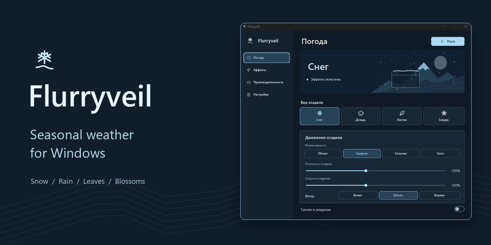

# Flurryveil

Interactive seasonal weather for the Windows desktop. Watch snow settle on windows and the taskbar, sweep it away with the pointer, or roll it into snowmen. Switch to rain, autumn leaves, or cherry blossoms from Settings or the tray.

**English** · [Русский](README.ru.md)



[](https://github.com/KarRich7/Flurryveil/releases/latest)

[](https://github.com/KarRich7/Flurryveil/actions/workflows/windows.yml)

## Download for Windows x64

| Package | How to use it |
| --- | --- |
| [Windows installer](https://github.com/KarRich7/Flurryveil/releases/download/v1.0.1/Flurryveil-1.0.1-win-x64-Setup.exe) | Install for your Windows account and open Flurryveil from Start. |
| [Portable ZIP](https://github.com/KarRich7/Flurryveil/releases/download/v1.0.1/Flurryveil-1.0.1-win-x64-Portable.zip) | Extract the archive and run `Flurryveil.exe`. |

[Release notes and SHA-256 checksums](https://github.com/KarRich7/Flurryveil/releases/tag/v1.0.1) · [All releases](https://github.com/KarRich7/Flurryveil/releases)

The packages target x64 editions of Windows 11 and Windows 10 build 19045 or later. Both include the .NET 10 runtime. The current settings interface is in Russian. The v1.0.1 executables are unsigned.

Run Setup again to update an installed copy. Use Windows **Settings → Apps → Installed apps** to remove it. Settings survive updates and removal in `%LOCALAPPDATA%\QuietSnow\settings.json`, including settings from the older «Тихий снег» build. The portable edition uses the same location.

## Use it

- Open **Погода** to choose precipitation, adjust density and fall speed, or set the wind. **Пауза** suspends all effects.
- Use **Эффекты** for window accumulation, garlands and their app list, or to clear precipitation. In snow mode, drag snow from a window edge to form a snowball. Roll it through settled snow to grow it. Stack two or three balls to make a snowman. Right-click to break a ball, or press Esc to release it.
- Use **Производительность** to select monitors, lower the frame limit to 30 FPS, or configure game, fullscreen, battery and application rules. The app also pauses when Windows locks or switches off the display.
- Use **Настройки** for the theme, Windows startup, and the snowplow. Ctrl+1 through Ctrl+4 open the four main sections. Closing Settings hides the window. Open it again from the tray, or choose **Выход** there to quit.

[Light theme](docs/screenshots/weather-light.png) · [Rain](docs/screenshots/weather-rain-light.png) · [Effects](docs/screenshots/effects-light.png) · [Performance](docs/screenshots/performance-light.png)

## Build and test

Use Windows, the [.NET 10 SDK](https://dotnet.microsoft.com/en-us/download/dotnet/10.0) version pinned in [global.json](global.json), and PowerShell 7.2 or later for packaging. The simulation and interface use C# and WinForms. Rendering uses Direct3D/DirectComposition with a GDI fallback.

```powershell
dotnet build Snowfall/Snowfall.csproj -c Release
dotnet run --project Snowfall.Tests/Snowfall.Tests.csproj -c Release
```

To package a release, install [Inno Setup 6.7.4](https://jrsoftware.org/isinfo.php) and run:

```powershell
pwsh -File eng/Build-Release.ps1
```

The installer, portable archive and SHA-256 manifest go to `artifacts/`. See [contributing](CONTRIBUTING.md) for the UI smoke test, renderer fallback and release steps. For v1.0.1, see the [release notes](docs/release-notes.md), [changelog](CHANGELOG.md), [architecture](docs/architecture.md), and [verification results](docs/verification.md).

## License and credits

A distribution and source license has yet to be selected. Packages include the license and notices shipped with the .NET runtime. Some seasonal weather ideas were inspired by Michael Bezruchko’s Snowhush. [Snowhush project](https://github.com/mbezruchko/Snowhush).
