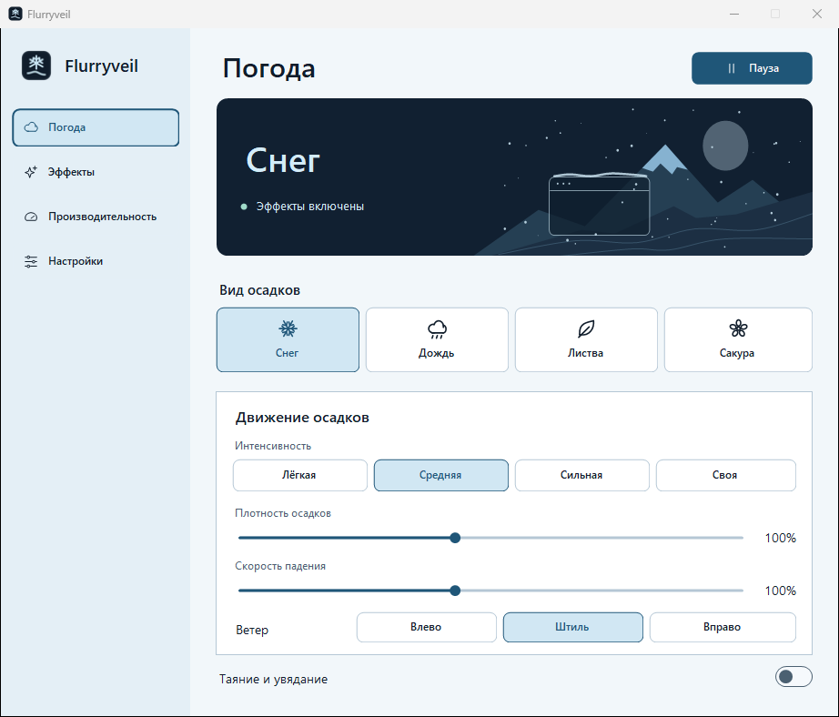

# Flurryveil

Снег, дождь, осенняя листва и лепестки сакуры на рабочем столе Windows. Снег ложится на края окон и панель задач. Его можно смахнуть курсором, скатать в снежок или собрать снеговика.

[English](README.md) · **Русский**

## Скачать для Windows x64

| Пакет | Как запустить |
| --- | --- |
| [Установщик Windows](https://github.com/KarRich7/Flurryveil/releases/download/v1.0.0/Flurryveil-1.0.0-win-x64-Setup.exe) | Запустите установщик, затем откройте Flurryveil из меню «Пуск». |
| [Portable ZIP](https://github.com/KarRich7/Flurryveil/releases/download/v1.0.0/Flurryveil-1.0.0-win-x64-Portable.zip) | Распакуйте архив и запустите `Flurryveil.exe`. |

Поддерживаются Windows 11 и Windows 10 начиная со сборки 19045. Среда .NET 10 уже включена в оба пакета. Выпуск 1.0.0 поставляется без цифровой подписи. [Описание релиза и контрольные суммы](https://github.com/KarRich7/Flurryveil/releases/tag/v1.0.0).

## Первые шаги

- **Погода** меняет вид осадков, скорость, плотность и ветер. Кнопка **Пауза** временно останавливает эффекты.
- **Эффекты** управляют сугробами, гирляндами и очисткой. Чтобы сделать снежок, зажмите снег на кромке окна и потяните. Поставьте два или три шара друг на друга, чтобы собрать снеговика.
- **Производительность** позволяет выбрать мониторы и настроить частоту кадров, паузу в играх и правила для приложений.
- **Настройки** содержат тему, автозапуск с Windows и снегоуборщик. Закрытие окна скрывает настройки в трей. Для полного выхода выберите **Выход** в меню значка.

Обновление и удаление сохраняют настройки в `%LOCALAPPDATA%\QuietSnow\settings.json`. Flurryveil читает настройки прежнего «Тихого снега» из этой же папки.

[Тёмная тема](docs/screenshots/weather-dark.png) · [Дождь](docs/screenshots/weather-rain-light.png) · [Сборка и тесты](README.md#build-and-test) · [Результаты проверок](docs/verification.md)
